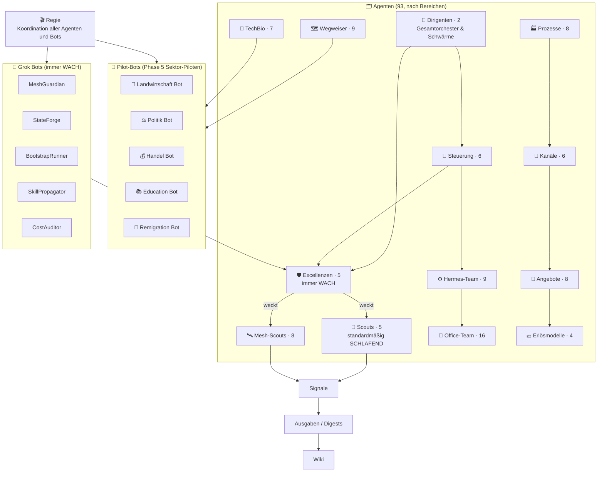

# ROSARY ATLAS Organigramm (Mermaid)

*Stand 19.10.2026 – öffentliche Fassung: Bots mit Namen (5 Grok Bots, 5 Pilot-Bots, Regie), alle übrigen Agenten nur als Gruppen mit Anzahl.*

*Organigramm – ROSARY-ATLAS V4 · Stand 09.10.2026*
